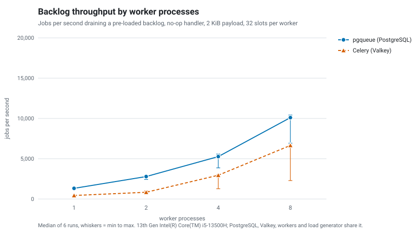
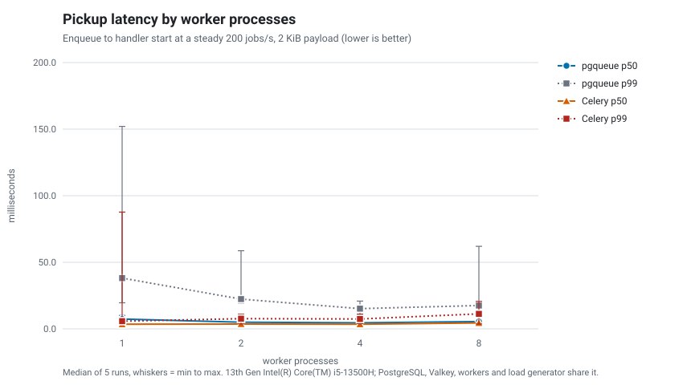

# Benchmarks

What the numbers in the README come from, how to reproduce them, and how far to trust them.
Short version: they were taken on a laptop that was busy with other work, the run-to-run
spread is large, and the honest summary is a range, not a point.

Run it yourself with `make bench` (about an hour with the defaults; `make bench-quick`
checks the setup in a few minutes and produces meaningless numbers). Everything below is
generated from [`bench/results.json`](../bench/results.json) by `python -m bench.report`
and the charts by `python -m bench.chart`; no number in this file is typed in by hand.

## Setup

| | |
|---|---|
| Machine | 13th Gen Intel Core i5-13500H, 16 logical CPUs, 14 GiB RAM, NVMe SSD, Linux 7.0 |
| PostgreSQL | 17.11 (`postgres:17-alpine`) in Docker, default configuration: `shared_buffers = 128MB`, `synchronous_commit = on`, `fsync = on` |
| Broker for the comparison | Valkey 8 (`valkey/valkey:8-alpine`, BSD-3-Clause fork of Redis; it reports itself as 7.2.4 for protocol compatibility), persistence off (`--save "" --appendonly no`) |
| Celery | 5.6.3 with redis-py 8.1.0, thread pool, defaults otherwise (prefetch multiplier 4, no result backend, `ignore_result`) |
| Python | 3.12.13 |
| Topology | Postgres or Valkey, the workers and the load generator all run on the same machine, workers as separate OS processes |
| Handler | no-op. This measures the queue, not your work |
| Job payload | JSON object of about 2 KiB (identifiers, short strings and a free-text body, deterministic). A 256 B and a 16 KiB variant are in the payload table |
| Concurrency | 32 job slots per worker process in both systems (asyncio tasks for pgqueue, threads for Celery) |
| Repetitions | 5 runs of every cell, the two systems interleaved inside each run |

Cells below are the **median over the 5 runs, with the minimum and maximum run in
brackets**. Raw per-run numbers, the load average at each measurement and the environment
are in `bench/results.json`.

### What is timed

* **Enqueue**: wall-clock time around each `enqueue()` call (pgqueue) or `apply_async()`
  call (Celery), measured by the client. The call returns after the job is committed in
  Postgres (with an fsync) or after the broker accepted the message into memory.
  `enqueue_many` inserts 1,000 jobs in one statement; Celery has no bulk publish, so it is
  not in that row.
* **Backlog throughput**: a backlog of 20,000 jobs is loaded first, then N worker
  processes start and drain it. The rate is taken between the 20th and the 95th
  percentile completion timestamp, so staggered worker start-up and the straggling tail do
  not count. pgqueue reads `finished_at` from its job rows; the Celery task records its own
  finish time in Valkey.
* **Pickup latency**: jobs arrive at a fixed 200 per second for 15 seconds (3,000 jobs)
  into idle workers, and the latency is the time from enqueue to the first line of the
  handler. pgqueue uses `started_at - created_at` (database clock, LISTEN/NOTIFY on, 1 s
  polling as fallback); Celery compares `time.time()` in the producer and in the task, on
  the same machine.

The Celery task makes one pipelined Redis call to record its timestamps, which pgqueue does
not need because its job rows already hold them. Celery is charged that extra round trip.

## Results

### Enqueue

| Variant | System | jobs/s | p50 ms | p95 ms | p99 ms |
|---|---|---:|---:|---:|---:|
| 1 client, 1 job per call | pgqueue | 184 (111-276) | 4.4 (3.2-5.7) | 11.7 (4.9-19.5) | 18.1 (9.6-66.5) |
| 1 client, 1 job per call | Celery + Valkey | 566 (348-1,715) | 1.7 (0.5-2.9) | 2.5 (0.9-4.3) | 4.2 (1.1-5.9) |
| 10 concurrent clients | pgqueue | 251 (175-378) | 30.8 (25.4-51.3) | 52.8 (28.9-145.9) | 100.8 (33.9-266.0) |
| 10 concurrent clients | Celery + Valkey | 634 (442-1,030) | 12.6 (7.1-18.8) | 36.4 (25.5-58.0) | 52.0 (42.3-89.7) |
| `enqueue_many`, 1,000 per call (latency is per call) | pgqueue | 6,188 (5,181-14,792) | 153.1 (66.1-190.4) | 221.0 (75.1-245.0) | 245.0 (81.5-258.4) |

### Backlog throughput (jobs/s)

| Worker processes | pgqueue | Celery + Valkey |
|---:|---:|---:|
| 1 | 825 (725-1,399) | 349 (280-499) |
| 2 | 1,702 (1,427-2,528) | 722 (574-1,268) |
| 4 | 3,915 (2,444-5,475) | 1,765 (990-3,354) |
| 8 | 4,161 (2,589-8,142) | 3,422 (1,683-6,747) |

### Pickup latency at 200 jobs/s (ms)

| Worker processes | System | p50 | p95 | p99 | max |
|---:|---|---:|---:|---:|---:|
| 1 | pgqueue | 7.3 (6.1-10.0) | 17.4 (14.8-21.3) | 38.2 (19.6-152.1) | 145.7 (50.7-276.8) |
| 1 | Celery + Valkey | 3.5 (2.7-5.3) | 5.1 (3.2-53.6) | 5.8 (3.7-87.7) | 15.7 (7.8-137.9) |
| 2 | pgqueue | 5.0 (3.9-6.3) | 12.5 (8.5-14.8) | 22.3 (19.4-58.6) | 166.0 (63.2-273.9) |
| 2 | Celery + Valkey | 3.6 (2.4-4.4) | 6.6 (3.3-8.5) | 7.6 (3.7-11.0) | 14.8 (6.5-20.4) |
| 4 | pgqueue | 4.5 (3.8-6.5) | 9.5 (5.4-14.2) | 15.2 (10.4-20.9) | 49.1 (28.3-255.1) |
| 4 | Celery + Valkey | 3.5 (2.7-4.2) | 5.9 (3.4-8.1) | 7.4 (3.9-11.0) | 12.6 (7.0-17.8) |
| 8 | pgqueue | 5.5 (3.8-7.2) | 12.4 (7.4-20.5) | 17.5 (10.2-62.0) | 90.2 (28.3-236.1) |
| 8 | Celery + Valkey | 4.5 (2.1-5.0) | 8.3 (3.3-12.9) | 11.3 (3.7-20.6) | 26.9 (7.6-40.8) |

### Payload size, 4 workers, backlog throughput (jobs/s)

| Payload | pgqueue | Celery + Valkey |
|---|---:|---:|
| 256 B | 2,998 (2,319-6,370) | 3,163 (1,029-3,737) |
| 2,048 B | 3,261 (2,329-4,873) | 2,281 (1,036-3,403) |
| 16,384 B | 2,931 (1,489-5,485) | 1,921 (984-2,911) |

Load average (1 minute) sampled at each measurement: min 2.3, median 10.4, max 37.7.

## How to read this

**The spread is as important as the median.** The laptop was also running unrelated work
(other benchmarks and containers) during these runs: the 1-minute load average was 38 when
the first run started and 4 to 5 when the last one finished, on a 16-thread CPU. The runs
that executed on a quieter machine are visibly faster. For example, 8 pgqueue workers
drained the backlog at 2,589, 3,893, 4,161, 5,665 and 8,142 jobs/s in runs 1 to 5, with
load averages between 19 and 4 at the time. A median of 4,161 jobs/s is therefore
a middle value of a noisy sample, not a property of the queue. Treat the figures as an
order of magnitude: low thousands of jobs per second per Postgres on a laptop, no-op
handler, default Postgres settings.

**Comparisons are more trustworthy than absolute numbers**, because both systems ran
inside the same run, a few seconds apart, under similar load. In the backlog scenario
pgqueue was faster than Celery in 5 of 5 runs at 1, 2 and 4 workers (1.2 to 2.8 times) and
in 4 of 5 runs at 8 workers (0.84 to 2.3 times; run 4 went to Celery, 6,747 against
5,665 jobs/s). With only 5 runs per cell and
that variance this is a pattern, not a significance test.

**Enqueue favours Celery, as it should.** A Valkey publish with persistence off is a memory
write; a pgqueue `enqueue()` is a durable commit. The gap on single-job enqueue is what
durability costs. If you enqueue inside a transaction you are committing anyway, the job
rides on that commit and adds one INSERT. If you can batch, `enqueue_many` amortizes the
commit across the batch.

**Pickup latency is low for both at this rate.** With idle workers the median is a few
milliseconds for both systems. Comparing the two within each run, pgqueue's median was
between 1.0 and 2.9 times Celery's. The tails differ more: pgqueue's p99 is tens of milliseconds, with single
outliers in the hundreds under load. Do not read the 1-worker row as a scaling effect; the
runs with a loaded machine dominate the maximum values.

**Celery on one worker is slow here** (hundreds of jobs/s) because one process with a thread
pool is limited by the GIL, while an asyncio worker spends its time waiting on the
database. A prefork pool, or the gevent pool, would change this comparison. It was not
tried, so there is no number for it.

## Why more workers help, and where SKIP LOCKED contention comes in

A pgqueue worker claims up to as many jobs as it has free slots with one statement
(`UPDATE ... FROM (SELECT ... FOR UPDATE SKIP LOCKED)`, see `store.py`). Without
`SKIP LOCKED`, two workers that select the same head of the queue would serialize: the
second one blocks until the first commits and then finds the rows taken. With it, a
claimer passes over rows another transaction has locked and takes the next ones in index
order, so N workers receive disjoint rows and never wait for each other.

The remaining cost of contention is skipping, not waiting. While other workers hold their
batches, the head of the ready-index is full of locked entries, and a claimer has to step
over them to find free rows. The more workers and slots, the more locked entries sit at the
head. Besides that, all workers insert and update rows of the same table and index pages,
and every completion is its own UPDATE and commit. In this benchmark the backlog throughput
went from 825 jobs/s with one worker to roughly 4,000 with four, but the step from four to
eight workers added little at the median (3,915 to 4,161 jobs/s) while the best runs kept
growing; with a noisy machine and a 16-thread CPU shared with Postgres itself, a CPU or
disk limit and the claim-side skipping cannot be told apart from these runs. This
benchmark did not instrument lock skipping, so the contention explanation above describes
how the mechanism works, not a measured cause of this curve. If you want to measure it,
compare `pg_stat_activity` wait events and the claim statement time (`pg_stat_statements`)
across worker counts on a dedicated machine.

## Caveats

* **One machine, one configuration.** Postgres, Valkey, the workers and the load generator
  compete for the same 16 threads and the same disk. On separate hosts the network adds
  latency and the CPU contention disappears. Neither is modeled here.
* **Noisy host.** See above. The load averages are stored with every measurement.
* **Five runs.** Enough to show the spread, not enough for confidence intervals.
* **No-op handler.** Real jobs spend time in their handler, which moves the bottleneck away
  from the queue. For handlers that take tens of milliseconds or longer, the queue is
  unlikely to be the limit at these rates.
* **Default Postgres.** `shared_buffers = 128MB` and the default WAL settings. Tuning
  would likely move the numbers, and it was not tried.
* **Durability is not equal.** pgqueue commits every job with an fsync; Valkey runs without
  persistence. A Valkey with `appendonly yes` would be slower to enqueue; it was not
  measured here.
* **Celery configuration.** One configuration (thread pool, 32 threads per process,
  defaults otherwise). Other pools and settings were not measured. RQ was not benchmarked.
* **Steady-state window.** Backlog throughput excludes the first 20% and the last 5% of
  the completions. It is not the time to drain the whole backlog.
* **The dataset is small.** The 20,000-job backlog stays in memory; a queue table of tens
  of millions of rows, bloat, autovacuum and retention were not tested.
* **Single-job enqueue measures a sequential client.** The "10 concurrent clients" row shares
  one asyncpg pool (pgqueue) or ten threads (Celery); both are bound by the same machine.
